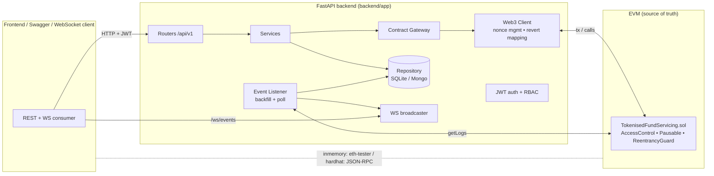

# Tokenised Fund Servicing Platform

An industry-grade, demo-ready implementation of a **Tokenised Fund Servicing Platform** —
a **Custody Hub**, a **Transfer Agency Engine**, and a **Reporting & Analytics Suite** —
built on a hardened Solidity contract and a clean FastAPI backend.

The chain is the **source of truth**; the backend enriches it with off-chain data,
role-based auth, indexed events, and dual-format reporting. It runs **fully locally with
one command** — no MetaMask, no browser wallet, no real funds. The backend signs
transactions itself using well-known local dev keys.

---

## Table of contents
- [Understand this in 2 minutes (start here)](#understand-this-in-2-minutes-start-here)
- [Architecture](#architecture)
- [Folder tree](#folder-tree)
- [Quickstart (one command)](#quickstart-one-command)
- [Chain modes](#chain-modes)
- [Environment variables](#environment-variables)
- [API reference](#api-reference)
- [5-minute demo (Swagger)](#5-minute-demo-swagger)
- [How this maps to the proposal](#how-this-maps-to-the-proposal)
- [Testing](#testing)
- [Build log (what each step added)](#build-log)

---

## Understand this in 2 minutes (start here)

### The idea in one line
A fund is split into **units** (like shares). People buy and sell units; the **blockchain
keeps the definitive record of who owns what**; the API adds names, permissions, and reports
on top.

### The 5 things that exist
| Thing | What it is |
|-------|------------|
| **Fund** | Has a **NAV** (total value) and a **unit price = NAV ÷ total units**. |
| **Investor** | Someone who owns units, identified by a wallet **address**. |
| **Order** | A request to **buy (subscribe)** or **sell (redeem)** units. Starts `PENDING`, becomes `SETTLED` once the operator processes it. |
| **Custody action** | **Locking** units as collateral so they can't be moved. |
| **Event** | Every action is recorded on-chain — this is the **audit trail**. |

### Who does what (the 5 roles)
Think of a real mutual fund. Each login maps to one job:

| Role (login) | Real-world equivalent | What they can do | What they **can't** do |
|--------------|----------------------|------------------|------------------------|
| **admin** | Compliance / operations head | Emergency controls: **pause** the whole fund, **freeze** a specific investor | Doesn't normally touch day-to-day orders |
| **agent** (Transfer Agent) | Back-office registrar | **Approve investors (KYC)**, **set the NAV price**, **settle** buy/sell orders | Can't do custody locks |
| **custodian** | The safekeeping bank | **Lock / release** units held as collateral | Can't approve KYC or settle orders |
| **auditor** | External auditor | **Read-only**: view reports and the audit trail | Can't change anything |
| **investor1..5** | The customer (you) | Place **buy/sell orders**, **transfer** units to another approved investor | Can only act for **their own** address |

> Password for every login is `demo`. For a quick tour, log in as **agent** — it can drive
> almost the whole flow.

### The normal lifecycle (who calls what)
```
1. agent      registers an investor            → status PENDING     POST /investors
2. agent      approves KYC                      → status APPROVED    POST /kyc/{addr}/approve
   (only APPROVED, non-frozen investors can hold or move units)
3. investor   places a subscribe order (buy)    → order PENDING      POST /orders/subscribe
4. agent      settles the order                 → units created,     POST /orders/{id}/settle
                                                   order SETTLED
5. agent      updates NAV as value changes       (max ±20% per step) POST /fund/nav
6. investor   redeems (sell) → agent settles     → units burned      POST /orders/redeem
7. custodian  locks some units as collateral      (can't be redeemed) POST /custody/actions
8. anyone     pulls statements / verifies a tx on-chain              GET /reports/... , /audit/...
```

**Why two steps (order → settle)?** In real funds you don't get units instantly — you place
an order and the transfer agent processes it at the official price. We model exactly that.

### What happens internally on one request (e.g. an investor subscribes)
```
Your request
   │  1. Is your JWT valid?            (core/security.py  — are you logged in?)
   │  2. Does your role allow this?    (require_roles(...) — investor or agent?)
   │  3. Business logic runs           (services/order_service.py)
   │  4. Sign & send a blockchain tx   (blockchain/contract.py + client.py, using that role's key)
   ▼
Smart contract updates balances   ← the SOURCE OF TRUTH (contracts/…​.sol)
   │  5. Result cached with extra info (repositories/ — names, notes, for fast lists)
   │  6. Background listener records the event and pushes it to the live feed (/ws/events)
   ▼
You get back: the order + tx hash + block number
```
**Rule of thumb:** the **blockchain is the truth**; the **database is just a fast, searchable
copy** with names attached. If they ever disagree, the chain wins — and `/audit/verify/{tx}`
proves it.

### So which endpoints do I actually use?
- **Just exploring?** Log in as `agent`, then: `POST /investors` → `POST /kyc/{addr}/approve`
  → `POST /orders/subscribe` → `POST /orders/{id}/settle` → `GET /fund/status`.
- **Want reports?** `GET /reports/fund/summary`, `GET /reports/investor/{addr}/statement`.
- **Want proof it's on-chain?** `GET /audit/events`, then `GET /audit/verify/{txHash}`.

Everything else in the [API reference](#api-reference) is a variation of the above.

---

## Architecture



**Flow:** routers validate input and enforce roles → services orchestrate business logic →
the contract gateway signs and sends transactions (backend-held dev keys) → the web3 client
handles nonces, gas and revert→HTTP mapping. A background event listener backfills from
block 0 and indexes on-chain events into the DB (audit trail) and a WebSocket feed.

---

## Folder tree

```
blockchain/
├── contracts/
│   └── TokenisedFundServicing.sol   # hardened contract (roles, orders, custody, pause)
├── test/
│   └── TokenisedFundServicing.test.js  # 17 Hardhat tests
├── scripts/
│   ├── deploy.js                    # deploy + assign roles + write deployments/local.json
│   └── export-artifact.js           # export ABI+bytecode for the Python inmemory path
├── deployments/
│   └── local.json                   # shared artifact (ABI + bytecode + address) read by backend
├── Token/                           # React console (TanStack Start + Tailwind + shadcn)
│   ├── src/lib/api.ts               # the ONLY place that calls the backend
│   ├── src/lib/types.ts             # shared UI contracts
│   └── src/components/fund/console.tsx  # all console pages
├── backend/
│   ├── app/
│   │   ├── main.py  config.py  logging_config.py  __main__.py
│   │   ├── api/v1/  health, auth, investors, kyc, orders, nav, transfers,
│   │   │            custody, admin, reports, audit, ws  (+ router.py)
│   │   ├── core/    security.py errors.py deps.py middleware.py context.py
│   │   │            ws_manager.py constants.py
│   │   ├── blockchain/  client.py contract.py compiler.py event_listener.py accounts.py
│   │   ├── services/    investor, order, nav, custody, report, audit, health
│   │   ├── repositories/ base.py sqlite_repo.py mongo_repo.py factory.py
│   │   ├── schemas/     pydantic request/response models
│   │   └── models/      domain enums (mirror the contract)
│   ├── scripts/seed_demo_data.py    # seed 5 investors, orders, NAV, custody
│   └── tests/                       # 14 pytest API tests (run on the inmemory chain)
├── hardhat.config.js  package.json  # Hardhat project
├── requirements.txt  requirements.lock.txt
├── Dockerfile  docker-compose.yml
├── Makefile  tasks.py               # task runner (tasks.py works without `make`)
├── .env.example
└── docs/proposal.md
```

---

## Quickstart (one command)

Prereqs: **Python 3.11+** and **Node 18+** (Node is only needed for `setup`/`hardhat` mode).

```bash
# 1) Install everything (npm deps, venv, Python deps, compile contract, export artifact)
python tasks.py setup

# 2) Run the whole demo: starts the API (inmemory chain + SQLite), seeds data, serves
python tasks.py demo
```

Then open **http://localhost:8000/docs**.

> On macOS/Linux with `make` installed you can use `make setup` / `make demo` instead.
> `tasks.py` exists because Windows has no `make`.

Run the API without seeding:

```bash
cd backend && ../.venv/Scripts/python -m app     # Windows
cd backend && ../.venv/bin/python -m app         # macOS/Linux
```

### Frontend console (`Token/`)

A TanStack Start + React console is wired to this API. With the backend running:

```bash
cd Token
npm install
npm run dev          # http://localhost:5173
```

Sign in with any demo account (password `demo`) — start with **agent**. All backend calls
live in `Token/src/lib/api.ts`; set `VITE_USE_MOCK=true` in `Token/.env` to run the UI on
offline demo data instead. See [Token/README.md](Token/README.md) for the full
page → endpoint map.

---

## Chain modes

Controlled by `CHAIN_MODE` (default `inmemory`).

| Mode | What it does | Needs Node running? |
|------|--------------|---------------------|
| `inmemory` | web3.py + **eth-tester** in-process EVM; backend funds dev accounts and deploys the prebuilt bytecode at startup | No |
| `hardhat`  | Connects to `npx hardhat node` over JSON-RPC; reads the deployed address from `deployments/local.json` | Yes |

**Hardhat mode:**

```bash
python tasks.py chain      # terminal 1: npx hardhat node
python tasks.py deploy     # terminal 2: deploy + write deployments/local.json
CHAIN_MODE=hardhat python tasks.py backend   # terminal 3
python tasks.py seed       # terminal 4
```

If anything blocks Node/Hardhat, keep `CHAIN_MODE=inmemory` — the whole system runs in
pure Python (the ABI+bytecode in `deployments/local.json` is already committed, and
`py-solc-x` can recompile as a fallback).

**Database:** `DB_MODE=sqlite` (default, zero-setup) or `DB_MODE=mongo`. If Mongo is
configured but unreachable, the backend automatically falls back to SQLite.

---

## Environment variables

| Variable | Default | Description |
|----------|---------|-------------|
| `CHAIN_MODE` | `inmemory` | `inmemory` (eth-tester) or `hardhat` (JSON-RPC) |
| `RPC_URL` | `http://127.0.0.1:8545` | Hardhat node RPC (hardhat mode) |
| `CHAIN_ID` | `31337` | Chain id |
| `FUND_NAME` | `Global Tech Fund` | Fund name set at deploy |
| `INITIAL_UNIT_PRICE` | `10000000000` | Starting unit price, PRICE_SCALE=1e8 (=100.0) |
| `EVENT_START_BLOCK` | `0` | Backfill start block for the indexer |
| `DB_MODE` | `sqlite` | `sqlite` or `mongo` |
| `SQLITE_PATH` | `backend/fund.db` | SQLite file |
| `MONGO_URL` / `MONGO_DB` | `mongodb://localhost:27017` / `fund_servicing` | Mongo connection |
| `JWT_SECRET` | `dev-secret-...` | JWT signing secret (set a real one in prod) |
| `JWT_ALGORITHM` | `HS256` | JWT algorithm |
| `JWT_EXPIRE_MINUTES` | `720` | Token lifetime |
| `CORS_ORIGINS` | `*` | Comma-separated allowed origins (frontend-ready) |
| `LOG_LEVEL` | `INFO` | Log level (structured JSON logs) |
| `DEV_*_KEY` / `DEV_INVESTOR_KEYS` | Hardhat keys | Well-known local dev signing keys |

See [`.env.example`](.env.example). **All keys shipped are public Hardhat dev keys.**

---

## API reference

All endpoints are under `/api/v1` and documented at `/docs` (OpenAPI at `/openapi.json`).
Auth: `POST /api/v1/auth/login` (or Swagger **Authorize**) with a demo user and password
`demo`. Demo users: `admin`, `agent`, `custodian`, `auditor`, `investor1`…`investor5`.

| Method | Path | Role | Purpose |
|--------|------|------|---------|
| GET | `/health` | – | API, chain, DB, latest block, contract address |
| POST | `/auth/login` | – | Get a JWT (OAuth2 password form) |
| GET | `/auth/demo-users` | – | Demo users, roles, addresses |
| POST | `/investors` | TRANSFER_AGENT | Register an investor (status PENDING) |
| GET | `/investors` | agent/auditor/custodian | List investors (filter `kyc_status`) |
| GET | `/investors/{address}` | any | Balance, value, KYC status, jurisdiction |
| POST | `/kyc/{address}/approve` \| `/reject` \| `/revoke` | TRANSFER_AGENT | KYC decisions |
| POST | `/orders/subscribe` | INVESTOR/agent | Create subscription order (`Idempotency-Key` supported) |
| POST | `/orders/redeem` | INVESTOR/agent | Create redemption order |
| POST | `/orders/{id}/settle` | TRANSFER_AGENT | Settle at current NAV |
| POST | `/orders/{id}/cancel` | INVESTOR/agent | Cancel a pending order |
| GET | `/orders` `/orders/{id}` | any | List / fetch orders (filters + pagination) |
| GET | `/fund/status` | any | Fund NAV, supply, unit price, paused |
| POST | `/fund/nav` | TRANSFER_AGENT | Update NAV (±20% bound enforced) |
| GET | `/fund/nav/history` | any | NAV update history |
| POST | `/transfers` | INVESTOR/agent | Compliance-checked unit transfer |
| POST | `/custody/actions` | CUSTODIAN | LOCK / RELEASE / TRANSFER |
| GET | `/custody/actions` `/custody/positions` | any | Custody log & positions |
| POST | `/admin/pause` \| `/unpause` | ADMIN | Global pause circuit-breaker |
| POST | `/admin/freeze/{address}` \| `/unfreeze/{address}` | TRANSFER_AGENT/ADMIN | Per-investor freeze |
| GET | `/admin/roles` | agent/auditor | Role directory |
| GET | `/reports/investor/{address}/statement` | any | Statement — `style=traditional\|blockchain-native`, `format=json\|csv\|pdf` |
| GET | `/reports/fund/summary` | any | Fund-level summary |
| GET | `/reports/transactions?from&to&type` | any | Paginated event report |
| GET | `/reports/nav-performance` | any | NAV performance series |
| GET | `/audit/events` | any | Indexed on-chain events (tx hash, block, ts) |
| GET | `/audit/verify/{txHash}` | any | Verify off-chain record against chain |
| WS | `/ws/events` | – | Real-time on-chain event stream |

Errors use a consistent envelope: `{"error": {"code", "message", "detail", "request_id"}}`.
Contract reverts are mapped to meaningful HTTP codes (e.g. `NotApproved` → 409,
`NavChangeTooLarge` → 400, `AccessControlUnauthorizedAccount` → 403).

---

## 5-minute demo (Swagger)

1. `python tasks.py demo`, then open **http://localhost:8000/docs**.
2. **Authorize** → username `agent`, password `demo`.
3. `GET /health` → chain connected + contract address.
4. `GET /reports/fund/summary` → seeded fund with 5 investors and settled orders.
5. `GET /investors` → the 5 seeded investors (KYC APPROVED).
6. `POST /orders/subscribe` `{ "investor": "<investor1 address>", "units": 50 }` → note the
   `order.id` and `tx_hash`.
7. `POST /orders/{id}/settle` → status `SETTLED`; `GET /fund/status` shows supply increased.
8. `POST /fund/nav` `{ "new_nav": <~+10%> }` → try `+200%` to see the ±20% bound reject.
9. `GET /reports/investor/{address}/statement?format=pdf` → download a PDF statement.
10. `GET /audit/events` → the on-chain trail; copy a `tx_hash` into
    `GET /audit/verify/{txHash}` → `matches: true`.
11. Connect a WebSocket client to `ws://localhost:8000/ws/events` and place another order to
    see it stream live.

Investor addresses come from `GET /auth/demo-users`.

---

## How this maps to the proposal

Implements the three core modules from [docs/proposal.md](docs/proposal.md) §Feasibility →
Solution Architecture. ✅ = demonstrated in this build; 🛣️ = productionisation roadmap.

**1. Tokenised Custody Hub**
| Proposal capability | This build |
|---|---|
| Real-time collateral management | ✅ `recordCustodyAction` LOCK/RELEASE + `lockedUnits`; locked units can't be redeemed/transferred; `/custody/positions` |
| Regulatory-grade audit trail for every custody action | ✅ Custody events indexed + `/audit/events`, `/audit/verify/{txHash}` |
| Multi-chain safeguarding (Ethereum, Polygon, private) | 🛣️ One EVM here (inmemory/hardhat); `CHAIN_MODE` abstracts the provider |

**2. Transfer Agency Engine**
| Proposal capability | This build |
|---|---|
| Smart contract-enabled fund accounting (issue/redeem/transfer) | ✅ Order lifecycle `/orders/*`, `/transfers`, settlement at NAV |
| Automated investor KYC/AML verification | ✅ Role-gated KYC (PENDING→APPROVED/REJECTED/revoke), jurisdiction, freeze/pause; 🛣️ external sanctions screening |
| Real-time NAV calculation & distribution | ✅ NAV-derived unit price with ±20% bound; `/fund/nav`, `/fund/nav/history` |

**3. Reporting & Analytics Suite**
| Proposal capability | This build |
|---|---|
| Dual-format reporting (traditional + blockchain-native) | ✅ `/reports/investor/{addr}/statement?style=…&format=json\|csv\|pdf` |
| Real-time transaction verification | ✅ `/audit/verify/{txHash}` reconciles off-chain record vs chain; `/ws/events` live feed |
| Regulatory package (AIFMD/SEC), investor portal | 🛣️ Report scaffolding present; jurisdiction-specific packs + UI are roadmap |

**Security & compliance alignment (proposal §3)**
| Proposal control | This build |
|---|---|
| RBAC with segregation of duties | ✅ `AccessControl` roles ADMIN/TRANSFER_AGENT/CUSTODIAN/AUDITOR mapped 1:1 to JWT roles |
| No plaintext PII on immutable ledger | ✅ Only address, KYC status, jurisdiction and a `kycHash` on chain; names/emails off-chain (Tier-1 data stays off-chain) |
| Immutable audit logging | ✅ Event indexer (backfill from block 0) + chain as source of truth |
| Encryption at rest/in transit, MFA, ZK privacy, SOC 2, data residency | 🛣️ Roadmap (this is a local demo, not a hosted deployment) |

Runs locally with no wallet/funds: `CHAIN_MODE=inmemory`, pre-funded dev accounts,
backend-side signing.

---

## Testing

```bash
python tasks.py test        # runs Hardhat (17) + pytest (14)
# or individually:
npx hardhat test
cd backend && ../.venv/Scripts/python -m pytest
npx hardhat coverage        # contract coverage report
```

- **17 contract tests**: roles, KYC lifecycle, order lifecycle, NAV bounds, pause, freeze,
  transfer restrictions, custody locks, pagination.
- **14 API tests**: health/auth/RBAC, investor+KYC, order flow + idempotency + revert
  mapping, custody locks, NAV bounds, reporting (CSV/PDF), audit verify — all run against
  the in-memory chain.

---

## Build log

The project was built step by step; each step updated `requirements.txt`, `package.json`
and this README:

- **Step 1 — Contract:** hardened `TokenisedFundServicing.sol` (OpenZeppelin AccessControl,
  Pausable, ReentrancyGuard; custom errors; NatSpec; paginated views), Hardhat tests, deploy
  script writing `deployments/local.json`. Added `@openzeppelin/contracts`, `hardhat`,
  `@nomicfoundation/hardhat-ethers`, `@nomicfoundation/hardhat-chai-matchers`,
  `@nomicfoundation/hardhat-network-helpers`, `ethers`, `chai`, `solidity-coverage`.
- **Step 2 — Backend:** clean architecture (routers/services/repositories/blockchain), both
  chain modes, SQLite+Mongo behind one interface, JWT+RBAC, structured logging, event
  listener, WebSocket. Added `fastapi`, `uvicorn`, `pydantic`, `pydantic-settings`, `web3`,
  `eth-account`, `eth-tester`, `py-evm`, `py-solc-x`, `aiosqlite`, `motor`, `PyJWT`,
  `python-multipart`.
- **Step 3 — APIs:** all endpoints above with OpenAPI docs, idempotency, pagination,
  filtering, dual-format reporting. Added `reportlab` (PDF).
- **Step 4 — Seed + docs:** `seed_demo_data.py`, this README, `requirements.lock.txt`,
  Makefile / `tasks.py` targets. Added `pytest`, `pytest-asyncio`, `httpx` (tests).

---

## Notes on the original contract

The starting `TokenisedFundServicing` used self-service KYC, instant buy/sell, and stored
investor names on chain. Two brief compatibility notes on the hardened version:

- KYC is now **transfer-agent controlled** (not self-service), and the flow is
  **order-based** (not instant). Legacy `UnitsPurchased` / `UnitsRedeemed` events are still
  emitted on settlement for backward compatibility.
- Investor **names are no longer stored on chain** (no PII on chain) — they live off-chain
  in the database; only address, KYC status, jurisdiction and a `kycHash` are on chain.
